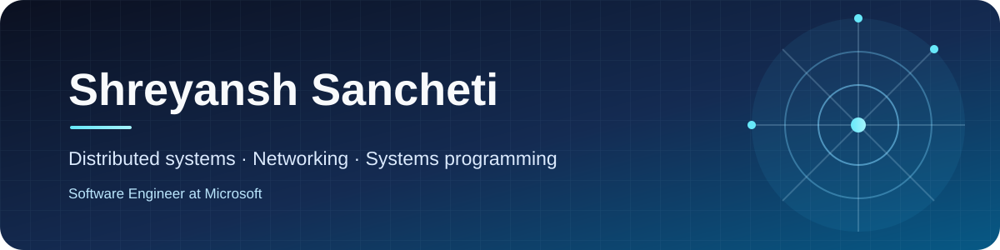

  

  <a href="https://portfolio-ssancheti.vercel.app">Portfolio</a> ·
  <a href="https://linkedin.com/in/shreyansh-sancheti">LinkedIn</a> ·
  <a href="https://calendly.com/007ssancheti">Let's talk</a> ·
  <a href="https://github.com/shreyanshjain7174">GitHub</a>

## About me

I'm a software engineer at Microsoft with a focus on networking, distributed systems, and systems programming. I've also worked on storage systems and enjoy building reliable infrastructure.

- **I work with:** C++, Rust, Go, and Python
- **I'm exploring:** Rook, Terraform, and OpenShift
- **I'm interested in:** AI infrastructure and open-source systems projects
- **Ask me about:** distributed systems, system design, networking, and cybersecurity
- **Resume:** [View my experience](https://drive.google.com/file/d/11kGCOTg9Xni6qq5fhO6AUCCtwVomouOD/view)
- **Contact:** [Email me](mailto:007ssancheti@gmail.com)

## Technologies

`C++` `Rust` `Go` `Python` `Kubernetes` `Ceph` `Docker` `Linux` `Terraform` `OpenShift`

---

  Always curious about the systems behind the software.

